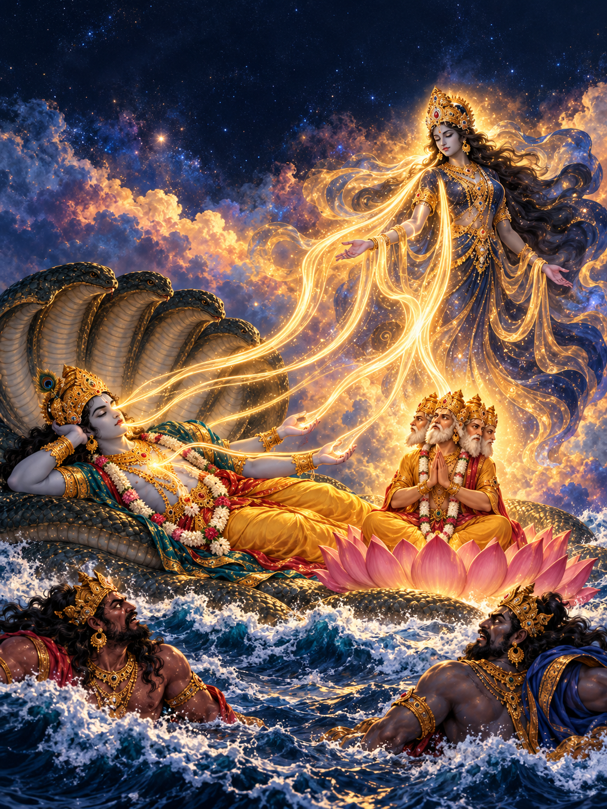

# DM02 Page 11 iconography review package

Status: **AWAITING AUTHORIZED HUMAN REVIEW**

Scope: DM02, Page 11, `page-b85332e92940926f67e6dd9d`, panel `p11-panel-01`

Scene: Yoganidra withdraws from Vishnu and appears before Brahma; Vishnu then begins to awaken.

Theological certification: **not performed and not claimed**

This package does not authorize image generation. It preserves the existing `ESCALATE_BEFORE_GENERATION` gate and narrows the review to source-silent visual choices.

## Existing proof under review

Immutable asset: `books/DM02/visual-proof-campaign/images/p11-panel-01/v0001.png`

SHA-256: `aa2104618b9f4395c1f62cdba279974f5be3a38b4ff78242182cc9d13438fa6c`

The independent actual-pixel review returned `ESCALATE`. The proof communicates a radiant feminine emergence and a coherent cosmic-ocean composition, but it does not make all six withdrawal groups separately auditable. It also fixes four visible Brahma heads, five Shesha hoods, an apparent multi-arm Vishnu treatment, a peacock-feather crown, and halo-like radiance that the locked Page 11 evidence does not certify. The occupied top caption region is a composition problem, not a theological defect.

## Exact textual floor

The locked records establish only the following visual facts for this moment:

1. At cosmic dissolution, Vishnu sleeps on Shesha above the universal ocean.
2. Brahma is seated on a lotus that grows from Vishnu's navel; Madhu and Kaitabha are nearby and threaten him.
3. Brahma asks the goddess to delude the demons and awaken Vishnu.
4. Yoganidra withdraws from six named locus groups: **eyes, mouth, nose, arms, heart and breast**.
5. She then appears separately before Brahma.
6. Freed from her, Vishnu rises awake; the page must not reverse that sequence.

Primary locators: `dm-evidence-004`, `dm-evidence-005`, `dm-evidence-006`, and `dm-sanskrit-evidence-006`; Devi Mahatmyam 1.89–91; Pargiter canto 81, web lines 87–99. The Sanskrit display reads the named loci in 1.90 and places the separate appearance and awakening in 1.91. The locked review performed no critical-edition collation.

The passage does **not** specify Brahma's head or arm count, Shesha's hood count, Vishnu's arm count or dress, Yoganidra's limb count, weapons or halo, exact light-ray count, internal bodily pathway, or order among the six loci.

## Attribute decisions for the reviewer

| Attribute | Classification | What is established | What remains open |
|---|---|---|---|
| Brahma on navel-born lotus | `DIRECT_TEXT_REQUIREMENT` | lotus seat, navel connection and presence before Yoganidra | stalk geometry, framing and scale |
| Brahma visible heads/crown | `SOURCE_SILENT` | four-faced treatments are documented conventions | visible count, hair/diadem/crown |
| Shesha supports Vishnu | `DIRECT_TEXT_REQUIREMENT` | serpent support above the flood | anatomy, scale and hood count |
| Multihooded serpent canopy | `TEXTUALLY_COMPATIBLE_TRADITION` | widespread and source-compatible | exact number and arrangement |
| Vishnu sleeps, is released, then awakens | `DIRECT_TEXT_REQUIREMENT` | action and sequence | pose details and degree of waking in one still |
| Vishnu arm count/crown/ornaments | `SOURCE_SILENT` | two- and four-armed reclining forms are documented | exact count and identity cues for DM02 |
| Two visible Vishnu arms without a total-count claim | `ARTISTIC_PROPOSAL` | preserves action and avoids a sacred-count assertion | requires human acceptance |
| Yoganidra as separate feminine divine presence | `DIRECT_TEXT_REQUIREMENT` | goddess and separate appearance before Brahma | body, dress, limbs and radiance form |
| Indigo-gold ambient radiance | `ARTISTIC_PROPOSAL` | makes withdrawal and presence legible | color, strength and shape |
| Circular halo, weapon array or fixed limb array | `FORBIDDEN_BY_LOCKED_SOURCE` | none needed for the action | not eligible without a new evidence and approval scope |
| Six named locus groups | `DIRECT_TEXT_REQUIREMENT` | eyes, mouth, nose, arms, heart, breast | visual grammar only |
| Exactly six literal rays | `SOURCE_SILENT` | the text names origins, not rays | number, path, color, duration |
| Six modest surface-origin cues | `ARTISTIC_PROPOSAL` | auditability without anatomy | requires human acceptance |
| Literal organs, exposed anatomy, body cutaway or seventh locus | `FORBIDDEN_BY_LOCKED_SOURCE` | locked treatment must be modest and non-anatomical | none |
| Cosmic ocean and nearby distinct demons | `DIRECT_TEXT_REQUIREMENT` | setting and current threat | palette and staging |
| Visible lotus stalk entering Vishnu's navel | `DIRECT_TEXT_REQUIREMENT` | cited Pargiter witness line 89 says the lotus grew from Vishnu's navel | exact stalk geometry and placement |

The complete row-level matrix is in `attribute-matrix.v0001.json`. It records no `UNRESOLVED_CONFLICT`: the open questions arise from source silence and regional variation, not contradictory locked witnesses.

## What established visual traditions do—and do not—show

Indian and Indian-influenced artworks provide usable context, not a single mandatory template:

- A circa-1760 Pahari Markandeya Purana painting at the Cleveland Museum shows four-armed Vishnu on a multiheaded serpent.
- A circa-1700 Chamba/Pahari painting at Cleveland shows seven serpent heads and a four-headed Brahma.
- an 1880–85 Calcutta `Shri Sheshanarayana` print at the Met shows ten hoods and pointed crowns.
- the Met's *Lost Kingdoms* catalogue documents a two-armed `Yogasayana` form under a Vaikhanasagama typology, so four arms are not the only documented reclining convention.
- a tenth-century Cambodian Brahma at the Met documents a four-face/four-arm convention in its own regional setting.
- an Archaeological Survey of India study of the Anantasayin temple panel treats the feminine form withdrawing from Vishnu as Yoganidra; a circa-1775 Bundelkhand Devimahatmya folio at LACMA shows another, multi-armed regional interpretation.

These examples demonstrate variation. They support recognizability choices but cannot turn heads, hoods, arms, crowns, weapons or halos into Devi Mahatmyam Chapter 1 requirements.

## Preferred source-safe Page 11 depiction

Use a 3:4 portrait composition with the complete top safe rectangle (`x=0.08..0.92`, `y=0.06..0.24`) left visually quiet for the locked narration.

Place Vishnu reclining across the lower-middle field on Shesha's clearly coiled support. Show only two scene-required arms and do not imply that two is his total divine arm count. His eyes should only begin to open after Yoganidra is visibly separate. No weapon, emblem, peacock feather or combat gesture appears.

Keep Shesha unmistakably serpentine, but crop, overlap or shadow the hood canopy so the total hood count cannot be audited as a theological claim. Keep Brahma lotus-seated in a three-quarter or partially occluded view so the composition does not assert a total head or arm count. Preserve a clear but discreet continuous lotus stalk from Vishnu's navel to Brahma's seat. Do not add the goose, Vedas, rosary, water vessel or other unrelated attributes.

Show Yoganidra as a distinct, dignified feminine draped presence before Brahma. Her drapery should prevent a count-readable arm array. Use soft ambient indigo-gold radiance, not a circular halo or weapon array.

At Vishnu's surface, show six small and separate origin cues: paired eyes, mouth, nose, paired arms, heart and breast. Give each a short independently traceable light motion, converging only after it clears the silhouette. This is a visual audit grammar, not a claim that the source describes six literal rays, internal organs or a permanent bodily residence. Keep the breast cue modest and external.

Place Madhu and Kaitabha as two distinct, distant and still-undefeated figures. Preserve the unchanged waters and do not include combat, defeat, Lakshmi, extra deities, unrelated geography or later narrative events.

## Six decisions requested from the human reviewer

1. Approve, revise or reject the count-neutral composition for Brahma, Vishnu, Shesha and Yoganidra.
2. Approve, revise or reject the restrained identity cues: indigo-blue Vishnu, ivory/yellow drape, simple low crown, and restrained Brahma hair/diadem—with peacock feather and weapon arrays excluded.
3. Approve, revise or reject Yoganidra as a feminine draped presence with ambient indigo-gold radiance, no fixed halo and no count-readable limb array.
4. Approve, revise or reject the six surface-origin cues, paired eyes/arms as semantic groups, and convergence outside the body without exactly six literal rays.
5. Approve, revise or reject the single-still sequence: Yoganidra is already separate while Vishnu only begins to wake, before combat.
6. Confirm or revise the implementation of the required navel-to-lotus connection while excluding Lakshmi, extra deities, goose, Vedas, rosary, sacred weapons/emblems, fixed sacred counts, anatomical cutaways and post-awakening events.

The reviewer should complete `human-review-decision.v0001.template.json` and identify their authority or qualification. The file is currently an unsigned template, not an approval record.

## Approval scope

If an authorized, independent, qualified reviewer approves these choices, that approval may permit an exact-scope iconography-clearance record and preparation of a Page 11 corrective prompt. A separate fresh authenticated campaign authorization would still be required before any image operation.

Approval would **not** authorize image generation, retry, another page, a full-book batch, character-reference promotion, theological certification, source-graph edits, PDF production, publication, deployment, push or merge. It would not retroactively approve the existing proof or transfer these conventions to another book or tradition.

## Blocking assessment and minimum resume action

No unresolved textual contradiction blocks a source-safe private illustration. The source-silent sacred choices are nevertheless a real **governance block for private generation under the current DM02 policy**, because the existing gate explicitly requires qualified human iconography review before Page 11 generation.

Minimum action to resume:

1. An authorized independent reviewer completes the six decisions against the exact input hashes.
2. The project records a narrow Page 11 iconography clearance (or requested revisions) without claiming theological certification.
3. If cleared, obtain a new authenticated authorization for at most one Page 11 operation; the closed corrective campaign and unused slot do not carry forward automatically.
4. After any future image operation, require a new independent actual-pixel review before reuse or reference promotion.

## Package files

- `input-manifest.v0001.json` — exact repository inputs, hashes, source IDs and external references.
- `attribute-matrix.v0001.json` — row-level source/convention classifications.
- `proposed-visual-conventions.v0001.json` — reusable but explicitly `PROPOSED` records for Brahma, Vishnu, Shesha and Yoganidra.
- `human-review-decision.v0001.template.json` — minimal unsigned reviewer decision form.
