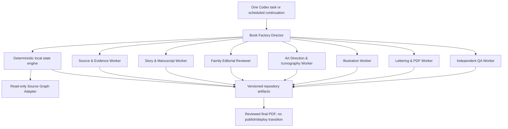

# Khatakshetra Autonomous Book Factory — Implementation Plan

> Foundation status: PR1 established the offline control plane. PR2 implements source-readiness dossiers, Story Packets, narrative/editorial contracts, bible validation, and scoped approval inheritance. See `docs/BOOK_FACTORY_FOUNDATION_PR2.md`. Manuscript generation remains deferred to PR3.

Status: architecture proposal only; no factory or book has been generated  
Audit date: 2026-10-16  
Repository: `https://github.com/soumyach/PuranaIthihasa`  
Audited branch/commit: `main` at `dae505d3b2e22c62471274b804219bcb56504670`  
Audit working branch: `audit/book-factory-implementation-plan`

## Executive decision

Build the Book Factory as a deterministic, repository-backed production engine controlled by one Codex Director. Codex specialist workers should create and review typed artifacts, while a local state engine owns validation, transitions, retries, cost limits, provenance, and resumption. Chat history must never be the system of record.

The factory should default to one active book, allow bounded parallel work only inside that book, regenerate at page level, and stop at a reviewed final-PDF artifact. It must not publish or deploy.

The repository has a strong source/evidence foundation and several useful content and print prototypes. It does **not** yet have a book-production engine, deterministic PDF pipeline, programmatic image provider, per-page quality gates, Git LFS configuration, or CI.

The authoritative `MYTHOLOGY_COMIC_RULES.md` is **not present on the audited `main` branch**. Its contents are therefore unknown and are not reconstructed here. Any future production run must fail closed at the standards gate until that exact file is supplied and approved. The palette, format, and visual direction stated in the audit brief are recorded below as brief-level requirements, not as invented contents of the missing file.

## 1. Verified repository inventory

### 1.1 Repository shape and deployment

- The repository is a static HTML/CSS/JavaScript site deployed through Vercel, with serverless functions under `api/` and SQL under `supabase/`.
- `vercel.json` contains clean URL rules, security headers, redirects, and one Vercel cron for the email drip route. That cron is unrelated to book production.
- `scripts/prerender.mjs` is a dependency-free Node ESM static-page generator for deity, festival, and temple pages.
- There are 739 tracked files at the audited commit.
- No `AGENTS.md`, `.codex/` project configuration, GitHub Actions workflow, `package.json`, lockfile, `requirements.txt`, or `pyproject.toml` exists.
- `.gitignore` excludes `config.js`, `.env`, and `.env.local`. This is useful hygiene, but it is not a secret manager.
- The repo does not use Git LFS: there is no `.gitattributes`, and the packed Git clone is approximately 111 MiB.

### 1.2 Source graph, evidence, spines, coverage, and validators

`research/source-graph/` is a mature, evidence-backed, offline-queryable research graph. Its portable contract is documented in `SCHEMA.md` and implemented in `validate_graph.py`.

Current verified counts from the executable validator:

| Record | Count/status |
| --- | ---: |
| Sources | 19 |
| Witnesses | 34 |
| Sources with passage reading | 9 |
| Passages | 1,025 |
| Fully extracted passages | 570 |
| Partially extracted passages | 446 |
| Evidence records | 1,351 |
| Entities | 3,515 |
| Verified assertions | 4,384 |
| Verified relationships | 3,928 |
| Verified boons / powers | 248 / 527 |
| Narrative events | 1,118, of which 1,101 are witness-verified |
| Story spines | 149: 93 `COMPLETE`, 56 `PARTIAL` |
| Variant/conflict records | 132 |
| Chapter coverage records | 701 |
| Extraction-queue tasks | 101 |

The graph preserves the claim chain `claim -> evidence -> passage -> witness -> source`, source-scoped identities, verification states, variants, incomplete coverage, resumable queues, stable IDs, change records, independent review reports, and SHA-256 inventories.

Relevant executable components:

- `query_graph.py`: offline commands for stats, sources, entities, relations, powers, story spines, evidence, and gaps.
- `validate_graph.py`: referential, evidence, status, event-order, coverage, and completeness checks.
- `test_integrity.py`: 15 negative and positive integrity tests, including evidence closure, source order, no completion overclaim, and query behavior.
- `complete_story_spines.json` / `COMPLETE_STORY_SPINES.md`: complete bounded arcs with embedded evidence.
- `chapter_coverage.json`, `source_coverage.json`, `COVERAGE_REPORT.md`: explicit complete/partial/in-progress/not-started units.
- `extraction_queue.json`, `RESUMABLE_QUEUE.md`, and checkpoint directories: precise research resumption state.

The Devī Māhātmya source is marked read, and the complete bounded `dm-story-shumbha` spine includes the Raktabīja sequence. In particular, `dm-event-040` records blood-drop replication and `dm-event-041` records the interception and defeat. The repository does not contain a standalone DM08 Book Factory record or standalone Raktabīja book manuscript.

### 1.3 Existing catalogues, manifests, and structured content

The following are useful catalogues or proto-manifests, but none is a production manifest:

- `content/story-packs/index.json`: four story packs with editorial status.
- `content/collections.json`: eight content collections.
- `content/launch-library.json`: four launch story packs, three booklet descriptions, drawing kits, and script types.
- `content/story-packs/*.json`: source brief, narratives, booklet plan, audio/script, visuals, activities, and a shallow workflow block.
- `content/templates/story-pack.schema.json`: a worked example object, despite its filename; it is not a formal JSON Schema with validation keywords.
- `research/source-graph/checkpoints/catalogue.json`: a research-source catalogue, not a book catalogue.

`content/launch-library.json` uses `pdfReady` and `print-ready-html` as product-planning flags. They must not be treated as evidence of a reproducible PDF pipeline. The as-is documentation itself says the storybook/booklet pages still need true PDF export.

### 1.4 Manuscripts, illustrations, PDFs, and reference assets

Existing book-like and print-oriented material:

- `storybook-ramayana.html`: printable, six-spread storybook prototype using existing art.
- `booklet-ramayana-starter.html`: print CSS and browser “Print / Save as PDF”; not a deterministic generated PDF.
- `coloring-book-ramayana.html`, `drawing-kit-ramayana.html`, and `paint.html`: functional coloring/drawing experiences.
- Four structured story packs include varying amounts of adult, child, audio, dialogue, descriptive, booklet, and visual-prompt content.

Tracked visual inventory includes 62 PNG, 32 JPG, and 14 SVG files. Notable groups are:

- `ChildrenBook/`: 13 Ramayana image pages, mostly 896 x 1200, plus a 1024 x 1536 cover.
- `Images/Ramayana/`: 13 illustrated Ramayana scenes, mostly 928 x 1152.
- `Images/ganapati/`: sixteen 900 x 900 form/adversary portraits.
- `Images/Diety/`, `Images/Vaahan/`, `Images/Dasavathar/`, `Images/home/`, and `Images/coloring/`.
- `assets/`: kit mockups, a Shani character image, a symbol wheel, and one embedded base64 text asset.
- `coloring/`: simple SVG coloring sheets.

Existing PDFs are three six-page A4 ReportLab-produced festival/DIY starter kits:

- `downloads/ganesha-diy-starter.pdf`
- `downloads/janmashtami-diy-starter.pdf`
- `downloads/raksha-bandhan-diy-starter.pdf`

No script that reproducibly creates those PDFs is tracked.

No path or non-source-graph text on `main` contains `Satyanarayana`, `Raktabija`, `DM08`, `The Enemy Who Multiplied`, or `Manuscript v2`. Raktabīja exists as source-graph evidence only. Therefore the stated Satyanarayana and Raktabija visual benchmark books and DM08 Manuscript v2 are not available in this checkout. They must be supplied rather than inferred.

### 1.5 Editorial, visual, and provenance direction already present

Reusable documentation:

- `docs/NARRATIVE_STYLE_GUIDE.md`: source briefs, variants, cinematic story structure, family readability, rights caution, and review checklist.
- `docs/VISUAL_AND_SCRIPT_GENERATION_PIPELINE.md`: media-pack concept, script types, prompt schema, visual identity guidance, asset metadata, and human review.
- `docs/CONTINUOUS_ENGINE_ARCHITECTURE.md`: source intake, graph building, story construction, media outputs, specialist roles, and human publication gates.
- `docs/MAHAGATHA_SYSTEM_PLAN.md`: source rights guardrails, lightweight ontology, agent roles, and provenance metadata.
- `docs/SITE_AS_IS_STATE.md`: honest distinction between real, structured, and missing content.
- `skills/khatakshetra-content-system/`: one repo-level Codex skill, three reference guides, and a public-copy audit script.

`scripts/prerender.mjs` already distinguishes `mula`, `tradition`, and `drishti` in public provenance badges. The Book Factory contract should normalize these to the required `MULA`, `SAMPRADAYA`, and `DRISHTI` enum. `KALPANA` is not currently implemented and must be added explicitly. Legacy `tradition` values may be migrated to `SAMPRADAYA` only through a recorded migration, not silently during rendering.

The audited repository does not contain the brief’s exact colors `#071F35`, `#D8AC4E`, and `#F6E8C6`. It does contain broader miniature/manuscript inspiration. The exact palette and portrait 3:4 format are requirements supplied by this audit brief.

### 1.6 Tests, dependencies, CI, automation, and external integrations

Observed tests:

- The source graph validator passed with zero errors and zero warnings.
- All 15 source-graph integrity tests passed.
- All structured JSON files inspected by this audit parsed successfully.
- `tests/diag.test.mjs` passed 7/7.
- `tests/drip.test.mjs` passed 21/21.
- Seven browser-oriented Node test files could not start because they import `jsdom`, while the repository has no package manifest or installed local dependency.
- `audit_public_copy.py` currently fails. It finds real TODO comments and many false positives because its broad `kg` expression also matches CSS classes such as `.kg-title`.

No CI workflow currently runs any of these checks.

Runtime integrations in the existing site use environment variables for Supabase, Gmail OAuth, and a Vercel cron secret. The repository proves which variable names are expected; it does not prove that credentials are present or valid in any deployment. No image-generation provider or OpenAI API credential is configured in repository code.

## 2. Existing components to reuse

| Existing component | Reuse in the Book Factory | Required boundary |
| --- | --- | --- |
| Source graph tables and IDs | Canonical research input and provenance links | Strictly read-only |
| `validate_graph.py` and `test_integrity.py` | Mandatory preflight and CI gates | Their pass means structural validity, not theological truth |
| `query_graph.py` | Offline source-worker query adapter and debugging | Wrap as read-only; capture command, graph hash, and result hash |
| Complete story spines and coverage reports | Candidate selection and source-readiness evidence | `COMPLETE` is bounded-arc completeness, not whole-corpus completion |
| Story-pack fields | Migration seed for manuscript, booklet, audio, activities, and visual briefs | Do not treat existing workflow/PDF flags as production approvals |
| Narrative Style Guide | Story and family-editorial rubric | Superseded where the missing authoritative comic rules eventually differ |
| Visual and Script Pipeline | Asset types, prompt metadata, and visual review concepts | Needs deterministic contracts and independent QA |
| Existing source badges | Public-facing provenance language | Add `SAMPRADAYA` and `KALPANA` contract semantics |
| Internal content-system skill | Pattern for future Director/worker skills | It is an operating manual, not an orchestrator |
| Ramayana storybook/booklet HTML | Layout and family-experience reference | Do not make it the production renderer without deterministic export tests |
| Existing images and PDF kits | Reference and regression fixtures where rights permit | They are not substitutes for unrelated story sources or missing benchmarks |
| Git/Vercel static site | Future consumer of approved artifacts | The factory must not deploy or publish |

## 3. Missing components and blockers

### Hard blockers before any book generation

1. `MYTHOLOGY_COMIC_RULES.md` is absent.
2. The Satyanarayana and Raktabija visual benchmark books are absent.
3. DM08 Manuscript v2 is absent.
4. No image provider is implemented in the repository, and no provider credential/budget is proven.
5. Git LFS or an approved same-repository binary-storage policy is not configured.
6. No licensed, repository-pinned font set exists for deterministic offline typesetting.

### Engineering gaps

- No Book Factory Director, worker contracts, CLI, or resumable state machine.
- No formal book manifest, source-readiness dossier, artifact record, approval record, QA report, or cost ledger schema.
- No immutable artifact versioning, idempotency ledger, durable external-call intent, or page dependency graph.
- No character/location/iconography bible format.
- No panel/page script format with separate narration and dialogue layers.
- No provider abstraction, mock provider, generation budget, or retry policy.
- No deterministic page compositor, font embedding, PDF assembler, render-to-image check, or final preflight.
- No independent editorial/visual QA worker or rule that prevents self-approval.
- No CI, dependency lock, code ownership, protected source-graph path, or factory test fixtures.
- No large-binary storage policy and no automated check preventing oversized normal-Git additions.
- No normalized distinction between Khatakshetra Kathas and Khatakshetra Originals / Kalpana.
- No approval inheritance across policy, line, collection, bible, and book scopes.

## 4. Codex capability matrix

The current environment exposes Codex skills, specialist subagents, local shell/file tools, Git worktrees, web access with approval controls, image-generation and image-inspection tool surfaces, PDF/document skills, and app-level task/automation controls. Official OpenAI documentation also describes durable sessions, resumability, skills, MCP tools, and multi-agent delegation in the managed Codex harness: <https://developers.openai.com/api/docs/guides/agents-api/overview>.

The factory must nevertheless distinguish an interactive Codex tool from a programmatic repository dependency.

| Capability | Verified in this audit | Classification | Factory implication |
| --- | --- | --- | --- |
| Agent skills | A session skill catalogue is available; the repo has one content-system `SKILL.md` | Configured in Codex; minimally configured in repo | Add one Director skill and narrowly scoped worker skills |
| Specialist subagents | The current Codex host exposes specialist-agent delegation with bounded concurrency | Configured in Codex, not wired to repo contracts | Director may delegate, but state/approval remains in files, never agent memory |
| Persistent/resumable execution | Codex supports durable sessions/tasks; the repository already models resumable research checkpoints | Available platform capability; factory state missing | Resume from `state.json` + event log so a new Codex turn can continue safely |
| Source-graph query/processing | Python 3, `jq`, graph query script, validator, and tests all ran locally | Configured and tested | Use directly behind a read-only adapter |
| Image generation/editing | A native Codex image generation/editing tool is exposed to this session | Tool surface configured; end-to-end call deliberately untested | Do not claim provider success, price, model, seed behavior, or API reusability yet |
| Programmatic image provider | No provider adapter or related secret is in the repo | Not configured; integrable | Add a fixture provider first; real provider requires an approved adapter and credential |
| PDF creation | Bundled Python imports for ReportLab, pdfplumber, pypdf, and Pillow succeeded | Configured locally, not declared by repo | A deterministic ReportLab/Pillow pipeline is feasible after dependencies are pinned |
| PDF render/inspection | Poppler `pdfinfo` and `pdftoppm` are available and existing PDFs were inspected | Configured and tested | Render every page to PNG for visual QA and geometry checks |
| Browser PDF route | Playwright package exists in the bundled runtime, but its configured Chromium binary does not | Partially configured | Do not base PR1 on browser print; either provision Chromium explicitly or use direct PDF composition |
| Local image inspection | Codex can inspect local images; Pillow is available | Configured | Use for independent page QA after deterministic rendering |
| Git branches/commits | Git 2.54 is installed; clone and audit branch creation worked | Configured locally | Use one branch/worktree per implementation PR or active book run |
| GitHub PR operations | `gh` CLI is absent; Codex exposes GitHub/app PR surfaces, but write auth was not exercised | Potentially available; authorization unknown | PR creation/push must remain an explicit authorized step |
| CI | No `.github/workflows/` files | Missing, integrable | Add offline CI in the first implementation PR |
| Secrets | `.env*` is ignored; deployment code expects Supabase/Gmail/Vercel values | Secret names known; values and access unverified | Use provider/deployment secret stores; never manifests, logs, prompts, or Git |
| External APIs | Network access is approval-controlled; site already calls Supabase/Gmail at runtime | Integrable with credentials and human authorization | No external call in tests; explicit allowlist, timeout, budget, and audit record in production |

Image-generation conclusion: the current Codex session has concrete tool evidence for native image generation/editing, but this audit did not invoke it because the task forbids image generation. There is no evidence that repository code can autonomously call the same tool, no provider has been selected, and no credential, quota, price, or spending authorization has been verified.

## 5. Proposed system architecture

### 5.1 Control plane and artifact plane



The Director chooses the next legal job; it does not invent state. The local engine validates inputs, acquires a one-book lease, records an event, delegates the job, validates outputs, records approvals or failures, and performs the transition. Workers communicate only through typed artifacts and validation reports.

### 5.2 Director responsibilities

- Enforce `max_active_books = 1` by default.
- Select only jobs whose dependencies and approvals are satisfied.
- Allow bounded internal parallelism after the manuscript and bibles are frozen. Recommended defaults are three total worker jobs and at most two concurrent image requests.
- Run source-graph validation before source work and confirm the graph tree is unchanged afterward.
- Enforce the standards, source readiness, approval, cost, and artifact-integrity gates.
- Persist all state before and after external calls.
- Resume incomplete work without repeating completed jobs.
- Stop on ambiguous external-call outcome, budget exhaustion, critical QA failure, missing authorization, or missing authoritative standard.
- Never push, open a PR, publish, deploy, email, or make a book public without an explicit separate action.

### 5.3 Specialist workers

1. **Source and Evidence Worker**
   - Queries the source graph read-only.
   - Produces a source-readiness dossier and beat-to-evidence map.
   - Makes gaps, variants, rights, and `NEEDS_REVIEW` claims visible.
   - Cannot edit `research/source-graph/` or approve its own dossier.

2. **Story and Manuscript Worker**
   - Develops or imports a versioned manuscript from an approved story brief.
   - Labels every beat/claim as `MULA`, `SAMPRADAYA`, `DRISHTI`, or `KALPANA`.
   - Produces page beats, narration, dialogue, emotional arc, and page-turn intent.
   - For DM08 acceptance, imports the supplied Manuscript v2 without rewriting unless the later task explicitly requests changes.

3. **Family-Reader Editorial Reviewer**
   - Reviews clarity, emotion, pacing, completeness, age suitability, dignity, and violence level.
   - Checks that a child can follow the action and an adult does not feel patronized.
   - Is independent from the manuscript worker and cannot mutate the reviewed artifact in place.

4. **Art Direction and Iconography Worker**
   - Creates immutable character, location, object, costume, palette, and iconography bibles.
   - Maps source-backed details to evidence IDs and separates style references from factual sources.
   - Enforces Indian miniature / Kalamkari-inspired devotional identity, the brief-level palette, and portrait 3:4 pages after the authoritative rules are present.
   - Treats Satyanarayana/Raktabija books as visual benchmarks only, never as unrelated story evidence.

5. **Illustration Production Worker**
   - Calls only an approved provider adapter with a reserved budget and idempotency key.
   - Produces art without baked narration/dialogue, preserving editable lettering.
   - Stores request, response, usage, provider/model, seed when available, input hashes, and every candidate outcome.
   - Regenerates a failed page or panel, not the entire book.

6. **Lettering and PDF Assembly Worker**
   - Uses structured narration/dialogue JSON as the source of truth.
   - Produces editable page source plus flattened proof render.
   - Enforces safe areas, bleed, reading order, contrast, font embedding, and metadata.
   - Assembles a deterministic PDF and renders it back to page images.

7. **Independent QA Worker**
   - Reviews artifacts produced by other workers in a separate context.
   - Runs source, editorial, iconographic, visual, lettering, continuity, and PDF preflight rubrics.
   - Cannot waive a critical failure. The Director may only retry, block, or request an authorized decision.

### 5.4 Editorial and visual invariants

- **Khatakshetra Kathas**: source-faithful adaptations. `MULA`, `SAMPRADAYA`, and clearly bounded `DRISHTI` are permitted. `KALPANA` cannot be silently inserted.
- **Khatakshetra Originals / Kalpana**: original fiction visibly labeled on cover metadata and colophon. Source-backed sacred/world details still retain evidence where used.
- Every material claim and visual iconography decision has a source class and, where applicable, evidence IDs.
- Character and location bibles are content-addressed and versioned. A changed bible invalidates dependent page approvals.
- Pages are portrait 3:4. The brief-level palette is midnight navy `#071F35`, antique gold `#D8AC4E`, and parchment `#F6E8C6`.
- Sequential panel pages and immersive full-page illustrations are both supported.
- Narration/dialogue remain separate structured layers; generated images should contain no lettering.
- Family readability, theological accuracy, iconographic accuracy, and source integrity are blocking gates.
- There is no `PUBLISHED` state and no deployment adapter in the factory.

### 5.5 Image provider abstraction and spending controls

Define a provider-neutral interface:

```text
ImageProvider.capabilities() -> capability record
ImageProvider.estimate(request) -> estimated cost/units
ImageProvider.generate(request, idempotency_key) -> provider result
ImageProvider.edit(request, idempotency_key) -> provider result
ImageProvider.recover(provider_request_id) -> prior result or UNKNOWN
```

The normalized request contains the page/panel ID, 3:4 geometry, prompt, negative prompt, character/location bible hashes, reference-image hashes, edit mask where applicable, output requirements, safety settings, and maximum authorized cost.

Required providers:

- `FixtureImageProvider` in PR1/PR3: copies deterministic checked-in test fixtures; never uses a network or money.
- A real provider adapter in a later PR, selected only after a canary evaluation. An OpenAI Images adapter is possible but requires an API credential and separate authorization. The interactive Codex image tool must not be assumed to be a callable repository API.

Cost policy must include:

- Hard `book`, `page`, `job`, and daily/cycle limits.
- Maximum candidates and repair attempts per page.
- Budget reservation before a call and reconciliation after it.
- No call when the provider cannot estimate within the remaining limit unless a human approves a bounded override.
- No silent fallback to a different provider/model, because that changes style and cost.
- An append-only ledger with requested and actual usage, excluding secret values.
- A durable `CALL_INTENT` event before every paid call. If a process crashes after submission, recovery queries the provider request ID. If recovery is impossible, the state becomes `EXTERNAL_RESULT_UNKNOWN`; the factory must not spend again automatically.

## 6. Exact proposed file/folder structure

The source graph and current site remain in place. New factory files should be additive:

```text
AGENTS.md
pyproject.toml
.github/
  CODEOWNERS
  workflows/
    book-factory-ci.yml

book_factory/
  __init__.py
  __main__.py
  cli.py
  director.py
  contracts.py
  state_machine.py
  events.py
  hashing.py
  locks.py
  approvals.py
  budgets.py
  source_graph.py
  jobs.py
  providers/
    images/
      base.py
      fixture.py
    text/
      base.py
      codex_artifact.py
  render/
    page.py
    pdf.py
    preflight.py
  qa/
    source.py
    editorial.py
    visual.py
    lettering.py
    continuity.py
    pdf.py

schemas/book-factory/
  book-manifest.schema.json
  source-readiness.schema.json
  manuscript.schema.json
  bible.schema.json
  page-script.schema.json
  artifact.schema.json
  state.schema.json
  event.schema.json
  approval.schema.json
  budget.schema.json
  qa-report.schema.json

skills/
  book-factory-director/SKILL.md
  book-factory-source-evidence/SKILL.md
  book-factory-story-manuscript/SKILL.md
  book-factory-family-editor/SKILL.md
  book-factory-art-iconography/SKILL.md
  book-factory-illustration/SKILL.md
  book-factory-lettering-pdf/SKILL.md
  book-factory-independent-qa/SKILL.md

book-factory/
  README.md
  config/
    defaults.json
    providers.example.json
  policies/
    source-policy.json
    approval-policy.json
    spending-policy.json
    qa-policy.json
  templates/
    manifest.json
    source-readiness.json
    page-script.json
  fixtures/
    synthetic-book/
    art/

books/
  catalogue.json
  collections/
    <collection-id>.json
  approvals/
    global/
      <approval-id>.json
    collections/
      <collection-id>/
        <approval-id>.json
  _artifacts/
    sha256/
      <first-two-hash-chars>/
        <full-hash>.<ext>
        <full-hash>.artifact.json
  <book-id>/
    manifest.json
    source-readiness.json
    run/
      state.json
      events.jsonl
      jobs/
        <job-id>.json
      cost-ledger.jsonl
    approvals/
      <approval-id>.json
    manuscript/
      v001/
        manuscript.json
        manuscript.md
        qa/
    bibles/
      characters.v001.json
      locations.v001.json
      iconography.v001.json
      visual-style.v001.json
    pages/
      001/
        script.v001.json
        layout.v001.json
        prompts/
        candidates/
        lettering/
          lettering.v001.json
          page.v001.svg
        proofs/
          page.v001.png
        qa/
          source.v001.json
          visual.v001.json
          lettering.v001.json
    proofs/
      book-proof.v001.pdf
      rendered-pages/v001/
    final/
      book.v001.pdf
      manifest.v001.json
      checksums.v001.txt
    provenance/
      source-map.v001.json
      artifact-index.v001.json
      software-bill-of-materials.v001.json

tests/book_factory/
  test_contracts.py
  test_state_machine.py
  test_resumption.py
  test_idempotency.py
  test_source_graph_read_only.py
  test_approval_inheritance.py
  test_budget_limits.py
  test_page_invalidation.py
  test_pdf_preflight.py
```

The two similarly named paths serve different purposes: `book_factory/` is importable code; `book-factory/` is human-readable configuration, policies, templates, and fixtures.

Runtime lease files and temporary render scratch belong under a gitignored, run-specific directory outside `books/`; durable state and every meaningful artifact/index stay under `books/`.

## 7. Production lifecycle and state transitions

### 7.1 Book-level state machine

```text
REGISTERED
  -> STANDARDS_CHECK
  -> SOURCE_READINESS
  -> STORY_BRIEF_READY
  -> MANUSCRIPT_DRAFTED
  -> SOURCE_QA
  -> FAMILY_EDITORIAL_QA
  -> MANUSCRIPT_APPROVED
  -> BIBLES_DRAFTED
  -> ICONOGRAPHY_QA
  -> BIBLES_APPROVED
  -> PAGE_PLANNING
  -> PAGE_PRODUCTION
  -> BOOK_CONTINUITY_QA
  -> PROOF_ASSEMBLY
  -> FINAL_QA
  -> FINAL_PDF_READY
  -> ARCHIVED
```

There is deliberately no state after `FINAL_PDF_READY` that publishes, uploads, deploys, sells, or emails the artifact.

Any active state may transition to one of these explicit non-success states:

- `BLOCKED_MISSING_INPUT`
- `BLOCKED_SOURCE`
- `BLOCKED_RIGHTS`
- `BLOCKED_STANDARD`
- `BLOCKED_AUTHORIZATION`
- `BUDGET_EXHAUSTED`
- `EXTERNAL_RESULT_UNKNOWN`
- `QA_FAILED_RETRYABLE`
- `NEEDS_HUMAN_DECISION`
- `FAILED_TERMINAL`

The state record contains the current state, state version, last event ID, active policy hashes, source-graph commit/hash, active artifact refs, invalidated refs, outstanding jobs, blocked reason, and next legal actions.

### 7.2 Page-level state machine

```text
PLANNED
  -> SCRIPT_APPROVED
  -> LAYOUT_APPROVED
  -> ART_REQUEST_READY
  -> ART_CANDIDATE_CREATED
  -> ART_QA
  -> ART_APPROVED
  -> LETTERED
  -> PAGE_RENDERED
  -> PAGE_QA
  -> PAGE_APPROVED
```

A retry creates a new candidate/version and preserves the failed one. It never overwrites an approved artifact. A page may return to the earliest invalidated state without resetting unrelated pages.

### 7.3 Resumability and idempotency

- Every transition is an append-only event with monotonically increasing sequence, timestamp, actor/worker, input hashes, output hashes, policy hashes, and result.
- `state.json` is a materialized view of `events.jsonl`; it can be rebuilt and must match replay.
- State writes are atomic: validate new state, write temporary file, fsync where supported, rename, then append/confirm the event using a documented recovery protocol.
- Each job key is `SHA256(book_id + stage + page_id + normalized_input_hashes + policy_hashes + worker_version + provider_config_hash)`.
- A completed job with the same key is reused. A changed input produces a new job and invalidates only downstream dependents.
- Artifacts are immutable and content-addressed. Logical page/book manifests point at hashes.
- A global lease prevents two Directors from advancing different books concurrently. Lease expiry and takeover are evented.
- Git commits occur at reviewable milestones, not after every minor event. The durable event log makes mid-milestone resumption possible.

### 7.4 Dependency invalidation

Examples:

- Manuscript beat changed -> affected page scripts, layouts, art, lettering, and QA become stale.
- Character bible changed -> every page referencing that character becomes stale from `ART_REQUEST_READY` onward.
- Lettering text only changed -> art remains approved; lettering/render/page QA are regenerated.
- Global visual standard changed -> all artifacts declaring the old standard hash are re-evaluated.
- Source evidence becomes `NEEDS_REVIEW` -> source approval and every dependent manuscript/page approval are invalidated.

## 8. Source-readiness requirements

### 8.1 Common contract

A source-readiness dossier is `READY` only when it records and validates:

1. Book ID, line (`KATHAS` or `ORIGINALS_KALPANA`), story scope, and audience.
2. Source-graph Git commit plus hashes of all queried graph files.
3. Source, witness, passage, evidence, event, story-spine, assertion, relationship, boon/power, and variant IDs used.
4. Successful graph validation at the recorded commit.
5. Beat/claim-to-evidence mapping with source class for every material assertion.
6. Verification status and a policy for every `NEEDS_REVIEW`, conflict, or unexamined gap.
7. Rights/adaptation status for each witness and any reference image.
8. Selected variant, alternatives considered, and rationale; unresolved theological differences remain visible.
9. Character, location, object, costume, weapon, vehicle, and iconography facts needed for the book.
10. Prohibited claims, depiction risks, age/violence concerns, and required reviewer expertise.
11. The exact `MYTHOLOGY_COMIC_RULES.md` content hash and approval ID.
12. Independent source-review approval over the dossier hash.

### 8.2 Khatakshetra Kathas

- A bounded `COMPLETE` story spine is preferred.
- A `PARTIAL` spine is blocked by default. A narrowly documented waiver may allow a book only if every used beat is independently evidence-closed and the omitted material cannot change the selected narrative meaning.
- `MULA` is direct text-backed adaptation.
- `SAMPRADAYA` is received/later tradition, named and separated from root-text claims.
- `DRISHTI` is interpretation or narrative framing and must not be presented as scripture.
- Invented dialogue/action may be used only under an explicit editorial policy, marked `DRISHTI`, and forbidden where it changes doctrine, motive, kinship, boon mechanics, iconography, or outcome.

### 8.3 Khatakshetra Originals / Kalpana

- The primary work classification is `KALPANA`.
- Cover, manifest, title page, and colophon must state that it is original fiction.
- Sacred figures, practices, and iconographic attributes used in the fictional setting still require a source-aware constraints dossier.
- No Kalpana episode may be promoted as a traditional or textual story.

### 8.4 DM08 eventual acceptance readiness

The source graph already contains the Raktabīja multiplication and counter events inside the complete Śumbha–Niśumbha bounded spine. That is useful evidence, but it is not sufficient to start DM08 production. Before the DM08 acceptance run, the repository must also contain:

- The supplied detailed Manuscript v2, imported without automatic rewriting.
- The authoritative `MYTHOLOGY_COMIC_RULES.md`.
- The actual benchmark asset package and usage/rights notes.
- A DM08 manifest and source-readiness dossier mapping manuscript beats to source-graph IDs, especially the relevant Raktabīja events and any preceding/following context used.
- An approved provider, spending cap, font pack, and Git LFS storage.

This audit does not create any of those DM08 production artifacts.

## 9. Failure recovery and approval policy

### 9.1 Failure recovery

| Failure | Automatic response | Escalation condition |
| --- | --- | --- |
| Schema/contract invalid | Reject output; worker repairs without transition | Three repeated failures |
| Source gap or conflict | Block affected beat; preserve dossier | Any doctrinal/iconographic ambiguity without policy resolution |
| Editorial QA fail | New manuscript version for failed findings only | Rewrite would change approved source choice |
| Art QA fail | New candidate for failed page/panel | Retry/cost limit reached or benchmark conflict |
| Lettering overflow | Reflow text/layout; keep approved art | Text reduction changes meaning |
| PDF preflight fail | Rebuild proof/final only | Missing font/license or renderer nondeterminism |
| Process crash | Replay events, inspect incomplete job, resume | External result cannot be recovered safely |
| Provider timeout | Query provider request before retry | Provider cannot confirm whether a billable result exists |
| Budget exhausted | Hard stop | Human raises a bounded cap |
| Source graph changed | Invalidate source approval and stop | Never auto-accept a changed graph snapshot |

Retries are page/job scoped. Whole-book restart is forbidden unless the root input invalidates the entire dependency graph.

### 9.2 Approval records

An approval is immutable and contains:

- Approval ID and decision (`PASS`, `PASS_WITH_CONDITIONS`, `FAIL`, `REVOKED`).
- Scope: global policy, product line, collection, shared bible, book, manuscript version, page version, or final PDF.
- Exact subject artifact hash and policy/rubric hashes.
- Approver kind and ID: human, specialist worker, automated validator.
- Timestamp, evidence/report refs, conditions, inheritance flag, expiry, and invalidators.

The creator of an artifact cannot issue its independent approval. Automated checks may approve only objective constraints; editorial, theological, iconographic, and final visual approvals require a distinct reviewer role.

### 9.3 Approval inheritance

Inheritance order is global policy -> product line -> collection -> shared bible -> book -> artifact, with the most specific valid record controlling.

An approval may be inherited only when:

- `inheritance_allowed` is true.
- The exact approved artifact/policy hash is reused.
- The target is within the declared scope.
- None of the listed invalidators changed.
- The target book records the inherited approval ID rather than copying its conclusion.

Safe examples: typography policy, palette, trim/bleed rules, collection character bible, or a shared location bible with the exact same hash.

Never inherit: story-specific source-readiness decisions, manuscript approval, page composition approval, theological conflict resolution for another story, or a benchmark book’s story facts. Satyanarayana/Raktabija benchmarks may transfer an approved visual-style profile only after the actual assets and rights are available.

## 10. Image, PDF, QA, and storage integration choices

### 10.1 Illustration choice

Use a provider-neutral adapter and a deterministic fixture provider first. Select a real provider later through a small canary set measuring:

- Character consistency across pages.
- Indian miniature / Kalamkari visual adherence.
- Iconographic correctness and controllability.
- Reference-image/edit support.
- Text avoidance and anatomy failure rate.
- 3:4 output quality and usable resolution.
- Cost, latency, retry/recovery API, terms, and commercial rights.

Provider selection is blocked until credentials, spending authority, benchmark assets, and the authoritative comic rules exist.

### 10.2 Editable page and PDF choice

Recommended source format:

- Page layout JSON for panels, crop boxes, balloons, narration boxes, z-order, bleed, and safe area.
- Lettering JSON for exact dialogue/narration strings and styles.
- SVG page source for editable vector lettering over raster art.
- PNG proof render for visual QA.
- PDF assembled deterministically from approved page sources.

The current environment supports a direct ReportLab/Pillow/pypdf route and Poppler rendering. This avoids depending on an absent browser binary. All dependencies and fonts must be pinned in the repository before production.

PDF gates:

- Correct 3:4 page boxes, bleed, safe area, order, and count.
- Embedded/subset licensed fonts and no missing glyphs.
- Minimum effective image resolution.
- No unexpected rotation, crop, transparency, or blank pages.
- Title/author/subject/version metadata and output checksum.
- Rendered-page pixel comparison within a documented tolerance.
- Independent visual inspection of every rendered page and cross-page continuity review.

### 10.3 Page quality gates

Each page must pass:

1. **Contract gate**: schema, hashes, dependencies, dimensions, and file readability.
2. **Source gate**: depicted action, participants, objects, iconography, and text map to approved beats/evidence.
3. **Visual gate**: character/location consistency, respectful anatomy, required attributes, composition, style, palette, and family-safe intensity.
4. **Lettering gate**: no baked-in generated text, correct text, reading order, fit, contrast, tails, margins, and minimum font size.
5. **Continuity gate**: costume, injuries, props, time, location, scale, and emotional progression match neighboring pages.
6. **Proof gate**: final composite and PDF render match the approved page sources.

Critical failures cannot be averaged into a numeric pass. A missing required attribute, unsupported theology, wrong speaker, cropped dialogue, or source contradiction fails the page regardless of other scores.

### 10.4 GitHub storage strategy

Use normal Git for code, JSON, Markdown, SVG lettering/layout sources, prompts, audit logs, approvals, checksums, and small thumbnails. Use Git LFS for new production PNG/TIFF/WebP source art, large proof renders, and PDFs.

Rules:

- Do not rewrite existing repository history in the first implementation PR.
- Add LFS only for future `books/**` binary patterns after the owner confirms quota/billing.
- Enforce file-size and LFS-pointer checks in CI.
- Preserve all generation candidates and finals as immutable content-addressed objects; manifests determine active versions.
- Use lossless masters plus explicitly derived optimized proofs. Never replace a master with a lossy derivative.
- If LFS is unavailable or quota is exhausted, block image production. Do not silently move artifacts to an unrelated storage service, because the mission requires repository preservation.
- GitHub Release assets may be evaluated later for distribution copies, but they are not a replacement for the versioned production source/artifact index.

## 11. Reviewable implementation PR sequence

### PR1 — Foundation: contracts, state, audit, and read-only guards

- Add the package/CLI skeleton, schemas, state machine, event log, job keys, content-addressed artifact index, approvals, budget policy, and synthetic fixtures.
- Add the one-active-book lease and bounded-concurrency configuration.
- Add a read-only source-graph adapter plus before/after hash and Git-diff guard.
- Add an explicit fail-closed standards check for missing `MYTHOLOGY_COMIC_RULES.md`.
- Add a fixture image provider interface only; no real provider or generated image.
- Add offline tests and CI. Do not add a real book manifest.

### PR2 — Source readiness and editorial artifacts

- Implement graph queries, source-readiness dossier generation, claim/beat classification, rights fields, and independent source QA.
- Implement manuscript, family-editorial, character/location/iconography bible, and approval-inheritance contracts.
- Migrate one synthetic fixture through source/editorial states; do not use DM08.

### PR3 — Page planning, provider abstraction, and cost safety

- Implement page/panel scripts, dependency invalidation, prompt packages, provider capability negotiation, cost reservation/reconciliation, and external-call recovery.
- Exercise only the deterministic fixture provider in CI.
- Add Git LFS configuration only after quota/billing approval.

### PR4 — Lettering, deterministic rendering, and independent QA

- Add editable lettering JSON/SVG, deterministic page rendering, PDF assembly, Poppler round-trip rendering, and source/visual/lettering/continuity/PDF QA reports.
- Use synthetic licensed fixtures and pinned fonts.
- Prove page-level regeneration without invalidating unrelated pages.

### PR5 — Authorized image-provider canary

- Add one selected real provider adapter behind secret storage and hard spending limits.
- Run a small non-DM08 canary only after explicit authorization.
- Record quality, cost, recovery, rights, and benchmark results; do not publish.

### PR6 — DM08 end-to-end acceptance

- Only after the authoritative rules, benchmark assets, DM08 Manuscript v2, storage, font, provider, and source-readiness prerequisites are present.
- Import, do not rewrite, Manuscript v2 unless separately authorized.
- Produce one complete reviewed book with page-level recovery, independent QA, and a final PDF.
- Stop at `FINAL_PDF_READY`; do not deploy or publish.

## 12. Acceptance criteria for PR1

PR1 is acceptable only when all of the following are demonstrated in CI and locally:

1. `python -m book_factory validate`, `status`, `next`, and a dry-run transition command work on a synthetic fixture.
2. No code path calls an external model, image provider, website, deployment, email, or paid service.
3. `research/source-graph/` remains byte-for-byte and Git-diff clean after every factory test.
4. The existing source-graph validator and all 15 integrity tests pass.
5. Formal schemas reject malformed manifests, source dossiers, states, events, approvals, budgets, artifacts, and QA reports.
6. Missing `MYTHOLOGY_COMIC_RULES.md` produces `BLOCKED_STANDARD`, not a fabricated fallback.
7. A Katha with missing evidence, unresolved disallowed claims, or incomplete required source mapping cannot advance to manuscript approval.
8. A Kalpana fixture cannot advance without explicit `ORIGINALS_KALPANA` and `KALPANA` labeling.
9. Illegal transitions and self-approval are rejected.
10. Only one book lease may be active; configured worker/image concurrency limits are validated.
11. Event replay reproduces `state.json` exactly.
12. A simulated crash/resume does not duplicate events, jobs, artifacts, approvals, or cost reservations.
13. Identical job inputs reuse the prior content-addressed output; changed inputs create a new version and invalidate only dependents.
14. A simulated ambiguous external result stops in `EXTERNAL_RESULT_UNKNOWN` and cannot automatically retry spending.
15. Approval inheritance succeeds only for exact hashes and declared scopes; invalidator changes revoke the inherited path.
16. CI runs offline with pinned tooling, includes file-size/LFS-policy checks, and requires no secrets.
17. The PR adds no DM08 manifest, manuscript, illustration, page, or PDF.
18. The PR adds no public publishing or deployment code.

## Audit execution report

### Verified

- Audited current `origin/main` at `dae505d3b2e22c62471274b804219bcb56504670`.
- Inspected source graph contracts, tables, spines, coverage, queues, evidence reviews, validators, and checkpoints.
- Ran the graph validator and all 15 integrity tests successfully without modifying the graph.
- Inspected structured content, story packs, catalogue-like files, internal skill, editorial/visual docs, static renderer, tests, APIs, deployment config, assets, and PDFs.
- Confirmed local PDF creation/inspection libraries and Poppler tools.
- Confirmed the Codex image tool surface exists but did not invoke it.
- Confirmed no Book Factory implementation, CI, Git LFS policy, provider adapter, authoritative comic rules, benchmark books, or DM08 Manuscript v2 exists on the audited branch.

### Uncertain or requiring authorization

- The missing authoritative rules and benchmark/manuscript files.
- Image-provider choice, output quality, price, commercial terms, credentials, and quota.
- GitHub push/PR permissions, branch protection, LFS quota/billing, and CODEOWNERS reviewers.
- Deployment secret presence and whether any existing image/reference assets have complete production-rights records.
- Final licensed font family and any human theological/iconographic reviewer roster.
- Whether the failing public-copy audit and missing `jsdom` dependency should be repaired in PR1 or a separate baseline-maintenance PR; they are existing repository issues, not caused by this plan.

### Next implementation prompt

> Implement PR1 from `docs/BOOK_FACTORY_IMPLEMENTATION_PLAN.md` on a new branch from current `main`. Build only the foundational contracts, deterministic state/event engine, read-only source-graph adapter and guards, synthetic fixtures, fixture provider interface, offline tests, and CI described in PR1 and its acceptance criteria. Do not modify `research/source-graph/`, do not invent `MYTHOLOGY_COMIC_RULES.md`, do not add or rewrite DM08, do not call image generation or any paid/external service, and do not add publishing or deployment. Run the existing source-graph validation/tests plus the new factory tests, then report the branch, commits, checks, and unresolved blockers. Do not create a PR unless explicitly asked.

